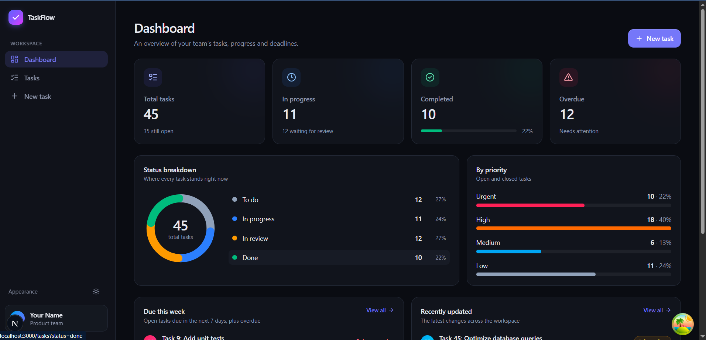
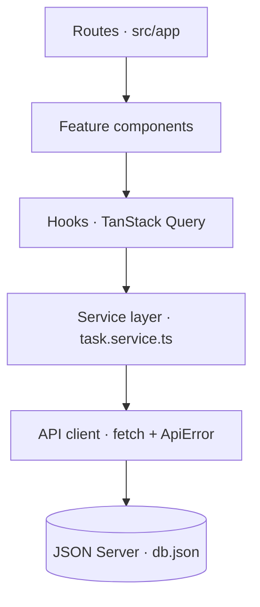
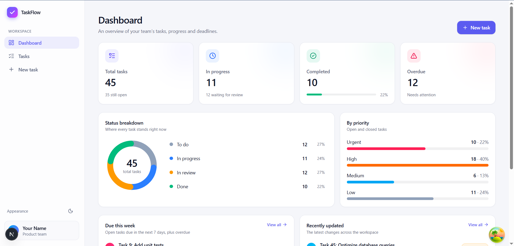
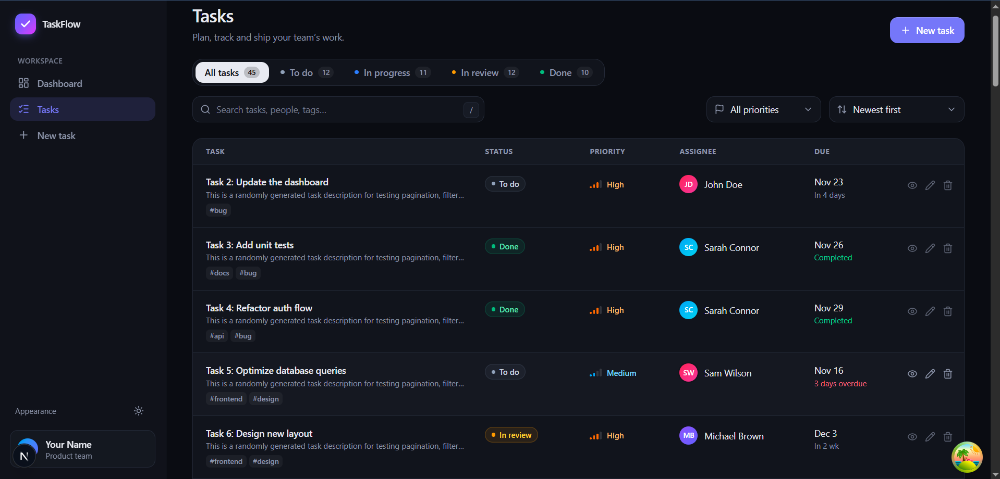
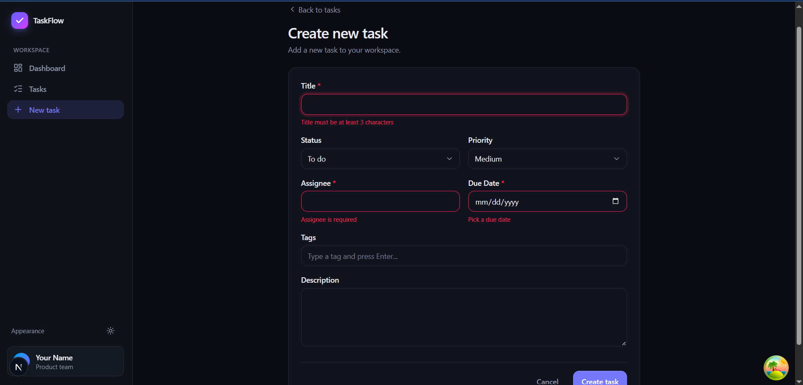
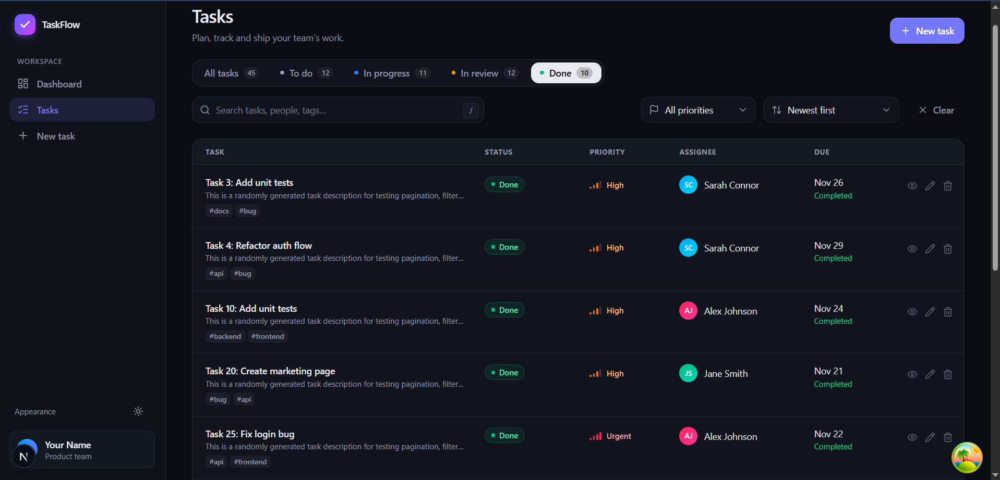
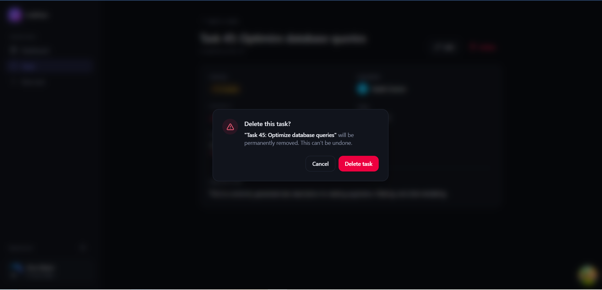
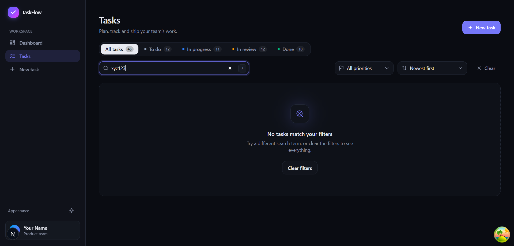
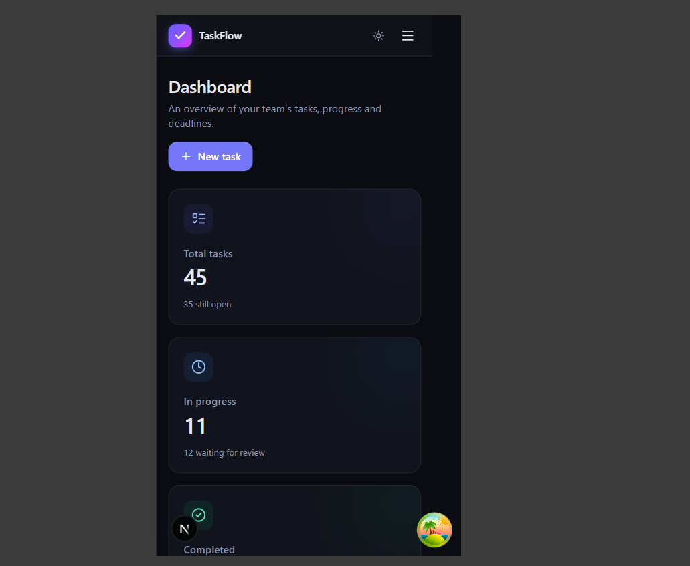

<div align="center">

# TaskFlow — Task Management Dashboard

A modern, responsive task management dashboard built with **Next.js**, **TypeScript** and **Tailwind CSS**,
backed by a JSON Server mock REST API.


<!-- Replace with your own links, or delete this line -->
**[Live demo](https://your-demo-url.vercel.app)** · **[Video walkthrough](https://your-video-link)**



</div>

---

## Table of contents

- [Overview](#overview)
- [Features](#features)
- [Tech stack](#tech-stack)
- [Getting started](#getting-started)
- [Available scripts](#available-scripts)
- [Mock API](#mock-api)
- [Project structure](#project-structure)
- [Architecture and design decisions](#architecture-and-design-decisions)
- [UI/UX and accessibility](#uiux-and-accessibility)
- [Requirements coverage](#requirements-coverage)
- [Screenshots](#screenshots)
- [Trade-offs and future improvements](#trade-offs-and-future-improvements)
- [Author](#author)

## Overview

TaskFlow lets a team create, organise and track tasks. It shows live statistics on a dashboard, and has a
searchable, filterable, paginated task list, a detailed view for each task, and validated forms for creating
and editing tasks.

The project was built as the technical assignment for the **Software Engineering Intern (Full-Stack & UI/UX
Design)** position at Pied Piper Innovation. Its focus is clean architecture, reusable components, type
safety and a polished, accessible interface.

## Features

### Dashboard

- Summary cards for total, in-progress, completed (with a completion-rate bar) and overdue tasks. Each card
  links to the matching filtered list.
- A ring chart of tasks by status, with an accessible legend that shows counts and percentages.
- A breakdown of tasks by priority.
- "Due this week" and "Recently updated" lists.

### Task management

- Full **CRUD**: create, view, edit and delete tasks. Deleting asks for confirmation first.
- Quick status tabs with live counts for each status.
- **Debounced search** across title, description, assignee and tags. Press `/` to focus the search box.
- Filter by **status** and **priority**, and **sort** by newest, oldest, due date, priority or title.
- **Pagination** with page numbers and "Showing 11–20 of 45".
- Search, filters, sort and page are stored **in the URL**, so views can be shared and survive a refresh,
  and the back button works.
- Due dates are shown in plain words ("Tomorrow", "2 days overdue") alongside the exact date.

### Forms

- Built with **React Hook Form** and **Zod**. One schema provides both the validation rules and the
  TypeScript type.
- Errors appear inline and are linked to their fields for screen readers.
- Focus moves to the first invalid field, and the submit button is disabled while saving.

### Experience

- **Light and dark themes** with a toggle. The theme follows your system setting by default, is remembered
  between visits, and doesn't flash on load.
- **Responsive** from 375 px phones to wide desktops: the sidebar becomes a slide-out menu, and the table
  becomes cards on small screens.
- Every async view has **loading, error, empty and success states**: skeleton placeholders, retry buttons,
  separate "no tasks yet" and "no results" screens, and toast notifications.

## Tech stack

| Concern | Choice |
| --- | --- |
| Framework | [Next.js 16](https://nextjs.org) (App Router), React 19 |
| Language | TypeScript (`strict` mode) |
| Styling | Tailwind CSS v4 with CSS-variable design tokens |
| Server state | TanStack Query v5 |
| Forms and validation | React Hook Form, Zod, `@hookform/resolvers` |
| Icons and feedback | Lucide React, Sonner (toasts) |
| Mock backend | JSON Server 0.17 |
| Tooling | ESLint, Prettier <!-- , Vitest + React Testing Library --> |

## Getting started

### Prerequisites

- **Node.js 20.9** or later
- **npm** (comes with Node.js)

### Installation

```bash
# 1. Clone the repository
git clone https://github.com/<your-username>/task-dashboard.git
cd task-dashboard

# 2. Install dependencies
npm install

# 3. Create your local environment file
cp .env.example .env.local      # Windows PowerShell: copy .env.example .env.local

# 4. Start the app and the mock API together
npm run dev
```

| Service | URL |
| --- | --- |
| Web app | http://localhost:3000 |
| Mock API | http://localhost:4000/tasks |

> The mock API adds a 400 ms delay on purpose, so you can see the loading states.

### Environment variables

| Variable | Default | Description |
| --- | --- | --- |
| `NEXT_PUBLIC_API_URL` | `http://localhost:4000` | Base URL of the REST API |

## Available scripts

| Command | Description |
| --- | --- |
| `npm run dev` | Starts Next.js and JSON Server together |
| `npm run api` | Starts only the mock API on port 4000 |
| `npm run build` | Creates a production build |
| `npm start` | Serves the production build |
| `npm run lint` | Runs ESLint |
| `npm run typecheck` | Runs the TypeScript compiler without emitting files |
<!-- | `npm test` | Runs unit and component tests (Vitest) | -->

## Mock API

The REST API is served by [JSON Server](https://github.com/typicode/json-server) from `db.json`. Version
**0.17.4** is pinned on purpose: the v1 beta uses a different query syntax for searching and pagination.

| Method | Endpoint | Description |
| --- | --- | --- |
| `GET` | `/tasks` | List tasks (supports the query parameters below) |
| `GET` | `/tasks/:id` | Get a single task |
| `POST` | `/tasks` | Create a task |
| `PATCH` | `/tasks/:id` | Update part of a task |
| `DELETE` | `/tasks/:id` | Delete a task |

| Query parameter | Example | Purpose |
| --- | --- | --- |
| `q` | `q=login` | Full-text search |
| `status`, `priority` | `status=in_progress` | Filter by field |
| `_sort`, `_order` | `_sort=dueDate&_order=asc` | Sorting |
| `_page`, `_limit` | `_page=2&_limit=10` | Pagination; the total is returned in the `X-Total-Count` header |

<details>
<summary><strong>Task data model</strong></summary>

```ts
interface Task {
  id: number;
  title: string;
  description: string;
  status: 'todo' | 'in_progress' | 'in_review' | 'done';
  priority: 'low' | 'medium' | 'high' | 'urgent';
  priorityRank: number; // 1–4, so that sorting by priority is meaningful
  assignee: string;
  tags: string[];
  dueDate: string;   // 'YYYY-MM-DD'
  createdAt: string; // ISO timestamp
  updatedAt: string; // ISO timestamp
}
```

</details>

## Project structure

```text
src/
├── app/                      # Routes only: thin pages that compose features
│   ├── layout.tsx            # App shell, fonts, theme script, providers
│   ├── providers.tsx         # QueryClientProvider and Toaster
│   ├── page.tsx              # Dashboard
│   └── tasks/
│       ├── page.tsx          # Task list
│       ├── new/page.tsx      # Create task
│       └── [id]/             # Task details and edit
├── components/
│   ├── layout/               # Sidebar, mobile menu, theme toggle
│   └── ui/                   # Button, inputs, card, dialog, pagination, avatar, states
├── features/
│   ├── tasks/
│   │   ├── api/              # task.service.ts: the only code that knows the API's query syntax
│   │   ├── hooks/            # useTasks, useTask, mutations, useTaskFilters
│   │   ├── components/       # Table, cards, toolbar, badges, form, details
│   │   ├── schemas/          # Zod validation schema
│   │   └── types.ts          # Task type and allowed values
│   └── dashboard/
│       ├── hooks/            # useDashboard: derives the statistics
│       └── components/       # Stat cards, charts, task lists
├── hooks/                    # Generic hooks (useDebounce)
└── lib/                      # API client, query client, helpers
```

## Architecture and design decisions



- **Layered data flow.** Components never call `fetch`. They use hooks, hooks call the service layer, and the
  service calls one shared API client. Replacing JSON Server with a real backend changes only the service and
  the client.
- **Each kind of state lives in the right tool.**
  - Data from the server lives in **TanStack Query**, which handles caching, retries, background refetching
    and refreshing the cache after changes.
  - List filters live in the **URL**.
  - Form state lives in **React Hook Form**.
  - Purely local UI state uses `useState`.

  A global store such as Redux wasn't needed.
- **The task shape is defined once.** Statuses and priorities are `const` arrays, and the TypeScript types and
  Zod schemas are derived from them. Labels, filters, validation and types can't drift apart.
- **Errors are handled in one place.** The API client turns every network or HTTP failure into an `ApiError`
  with a readable message. Queries don't retry on a 404, and mutations show toast feedback.
- **Feature folders.** Everything about tasks lives in `features/tasks`, so features stay independent and easy
  to find.
- **Design tokens.** Colours are CSS variables (`surface`, `foreground`, `muted`, `border`, `primary`) mapped
  into Tailwind, so the light and dark themes come from one set of components.
- **Dashboard refreshes automatically.** Every query key starts with `'tasks'`, so any create, update or delete
  refreshes both the list and the dashboard.

## UI/UX and accessibility

- Semantic structure: `header`, `nav`, `main`, real `<table>` markup with column headers, and one `h1` per page.
- Fully usable by keyboard, with visible focus rings and a "Skip to content" link.
- Dialogs and the mobile menu use the native `<dialog>` element, which keeps focus inside, closes with Esc and
  returns focus afterwards.
- Every form field has a label. Errors are linked with `aria-describedby`, and invalid fields set
  `aria-invalid`.
- Status and priority are never shown by colour alone: each has a text label, plus dots or signal bars.
- Icon-only buttons have descriptive `aria-label`s, such as "Delete Design onboarding flow".
- Animations respect `prefers-reduced-motion`, and native controls follow the theme through `color-scheme`.

## Requirements coverage

| Requirement | Implementation |
| --- | --- |
| Dashboard with statistics | Summary cards, status chart, priority breakdown, due-soon and recent lists |
| CRUD | Service layer and TanStack Query mutations, with confirmation, toasts and cache refresh |
| Search, filter, sort, paginate | Debounced search, status tabs, priority filter, sort menu and pagination, all stored in the URL |
| Task details | A page per task with its details, actions and a "not found" state |
| Forms and validation | React Hook Form and Zod with accessible inline errors |
| Responsive design | Sidebar becomes a slide-out menu, table becomes cards, layouts tested from 375 px |
| Loading, error, empty and success states | Skeletons, retry, two kinds of empty screen, toasts |
| TypeScript and best practices | Strict mode, derived types, no `any`, layered architecture |

## Screenshots

<!-- Save screenshots in docs/screenshots/ with these names, or update the paths below. -->

| Dashboard (dark) | Dashboard (light) |
| --- | --- |
|  |  |

| Task list | Create task with validation |
| --- | --- |
|  |  |

| Task details | Delete confirmation |
| --- | --- |
|  |  |

| Empty state | Mobile |
| --- | --- |
|  |  |

## Trade-offs and future improvements

**Trade-offs**

- Dashboard statistics are calculated in the browser from all tasks. That's fine for a mock API; a real
  backend would provide a dedicated `/stats` endpoint.
- JSON Server's search is a simple substring match, and its data resets if `db.json` is restored.

**What I would add next**

- Authentication and per-user task lists.
- A Kanban board view with drag and drop.
- Instant (optimistic) updates for every change, with rollback if the server fails.
- End-to-end tests with Playwright, plus visual regression checks.
- Bulk actions and CSV export.

## Author

**Hiruni Nimeshika Dehimaduge**

- Email:hirunidehimaduge@gmail.com
- LinkedIn:https://www.linkedin.com/in/hiruni-nimeshika-6353a839a
- GitHub:https://github.com/hiruni-nimeshika

---

<div align="center">
Built with care for the Pied Piper Innovation internship assignment · 2026
</div>
